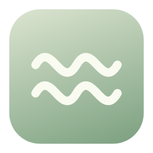
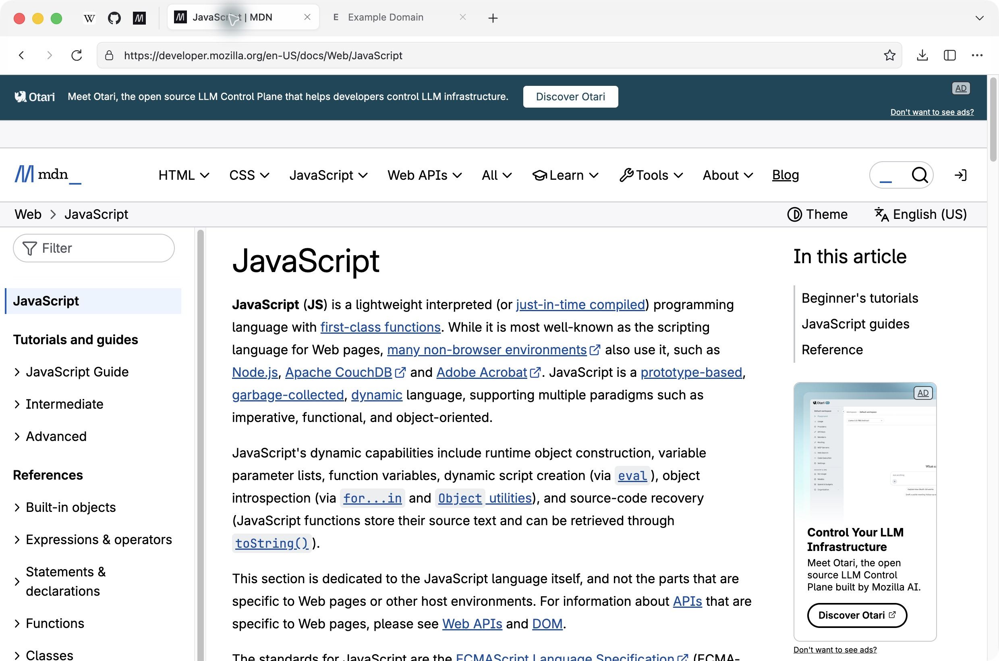
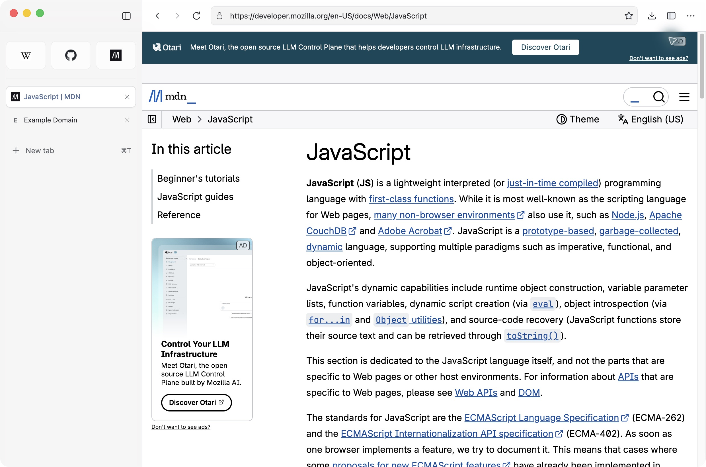
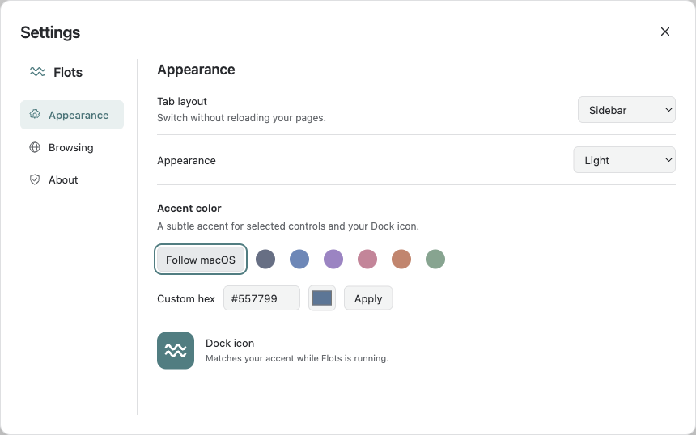

# Flots

<p align="center">
  
</p>

<p align="center">A compact Chromium browser for your Mac. More room for the web.</p>

<p align="center">
  
  
  
  <a href="LICENSE"></a>
</p>

<p align="center">
  <a href="https://github.com/aritheprogramer/flots/releases"><strong>Download Flots</strong></a> ·
  <a href="#installation">Installation</a> ·
  <a href="docs/COMPATIBILITY.md">Compatibility</a> ·
  <a href="https://github.com/aritheprogramer/flots/issues">Report a bug</a>
</p>

## Overview

Flots is a free, open-source macOS browser with a compact two-row toolbar, an optional sidebar and up to nine pinned favorites. It uses Chromium for websites, native macOS window controls and native Liquid Glass where supported.

It is an early preview, not a universal replacement for every browser workflow. Known limitations are listed below rather than hidden behind a feature checklist.

## Preview



<details>
<summary>Sidebar and appearance settings</summary>





</details>

## Compatibility

| Environment | Status |
| --- | --- |
| Apple Silicon, macOS 27 | Tested on an M1 Mac with 8 GB memory |
| Intel Macs | No build provided |
| Earlier macOS versions | Not validated for this release |
| Windows / Linux / iOS | Not supported |

> [!IMPORTANT]
> Flots is distributed without a paid Apple Developer membership. Releases have a verified ad-hoc signature but are **not Developer ID signed or notarized**. macOS may block the first launch. This preview does not support iCloud passkeys, DRM streaming services or Chrome extensions. Do not use it as your only browser if you depend on those features.

## Features

- **Compact Top or Sidebar** — switch layouts without reloading your pages.
- **Nine pinned favorites** — reorder them and open them with ⌘1–⌘9.
- **Tabs and navigation** — reopen closed tabs, search local history, find in a page and open links from other apps.
- **Personal appearance** — light, dark or system appearance, custom accent colors and a matching runtime Dock icon.
- **Downloads, page saving and printing** — visible download progress, ⌘S and ⌘P.
- **Persistent website data** — cookies, local storage, IndexedDB and caches remain in a local Chromium profile. Websites control session expiration.
- **Measured memory** — a discreet process-memory indicator, lazy session restoration and manual tab discarding. Regular tabs are not automatically discarded.
- **Basic ad and tracker blocking** — a small bundled network rule list; not a complete tracking-prevention service.

## Installation

1. Download `Flots-<version>-macOS-arm64.dmg` from [Releases](https://github.com/aritheprogramer/flots/releases).
2. Open the disk image and drag **Flots.app** into **Applications**.
3. Open Flots from Applications. Quit an older instance first.
4. If macOS blocks this non-notarized app and you trust the downloaded release, follow Apple's per-app **Open Anyway** procedure in **System Settings → Privacy & Security**. [Official Apple instructions](https://support.apple.com/en-us/102445).

Do not disable Gatekeeper globally. If macOS reports that the app is damaged or contains malware, do not treat that warning as the ordinary unidentified-developer prompt: download again from the release page, verify its checksum and report the problem.

Each release includes `SHA256SUMS.txt`. In the download directory:

```sh
shasum -a 256 -c SHA256SUMS.txt
```

A checksum detects a mismatched download; it is not a replacement for publisher signing.

To make Flots your default browser, use **Settings → Browsing → Make default…** and confirm the macOS prompt. This is optional.

## Updates

Updates are manual. Download the next release, quit Flots and replace the application in Applications. Your profile is stored separately and is retained. There is no automatic updater in this preview. Keep up with releases: Chromium security updates matter for a browser.

## Known limitations

- iCloud passkeys, including Google sign-in with an iCloud passkey, are unavailable. Use another login method offered by the site.
- No DRM/Widevine integration, Chrome extensions, password autofill or password manager.
- Some authentication flows rely on popup/opener behavior that is not fully implemented.
- Session-only cookies and `sessionStorage` are not restored after a full quit. Persistent login cookies are saved; sites may still expire or revoke them.
- Discarding or restarting a page does not preserve its unsaved forms or live JavaScript state.
- Complete spoken VoiceOver, hardware capture, physical printing and long-duration testing across many Mac models remain incomplete.

See the [compatibility matrix](docs/COMPATIBILITY.md), [privacy information](docs/PRIVACY.md) and [security policy](SECURITY.md).

## Building from source

Requirements: an Apple Silicon Mac, Node.js 24+, npm, Node headers and Xcode Command Line Tools with the macOS 26+ SDK. GUI tests require a logged-in graphical session. An Apple Developer subscription is not required for a local build.

```sh
git clone https://github.com/aritheprogramer/flots.git
cd flots
npm ci
npm run dev
```

Build the application and verified disk image:

```sh
npm run package
```

Outputs are stored in `release/v<version>/`. `release/Flots.app` points to the latest verified application. Existing release versions are never overwritten. See [build documentation](docs/BUILD.md).

## Testing

```sh
npm test
npm run test:runtime
npm run test:storage
npm run test:webauthn
npm run test:v3
node scripts/compatibility-test.mjs
node scripts/interaction-test.mjs
```

Tests use isolated profiles. WebAuthn tests use a virtual authenticator; passing them does **not** validate iCloud or a physical security key. Screenshot comparisons cover both layouts and light/dark appearances. CI runs source checks; native macOS integration and installer checks are run locally.

## Repository structure

```text
src/main/       Browser lifecycle, sessions, downloads and security
src/renderer/   Browser chrome and settings
src/shared/     Validated state and navigation models
native/         Small AppKit Liquid Glass bridge
scripts/        Build, package and integration checks
tests/          Unit tests and visual regression scenarios
assets/         Original icon and starter network rules
docs/           Compatibility, privacy and build notes
```

## Credits and license

Built with Electron, Chromium and Ghostery's blocking engine. See [third-party notices](THIRD_PARTY_NOTICES.md). README presentation is inspired by [AirCard-iOS](https://github.com/Mak5er/AirCard-iOS); the projects are not affiliated.

Flots source is available under the [MIT license](LICENSE). Third-party components retain their own licenses.
